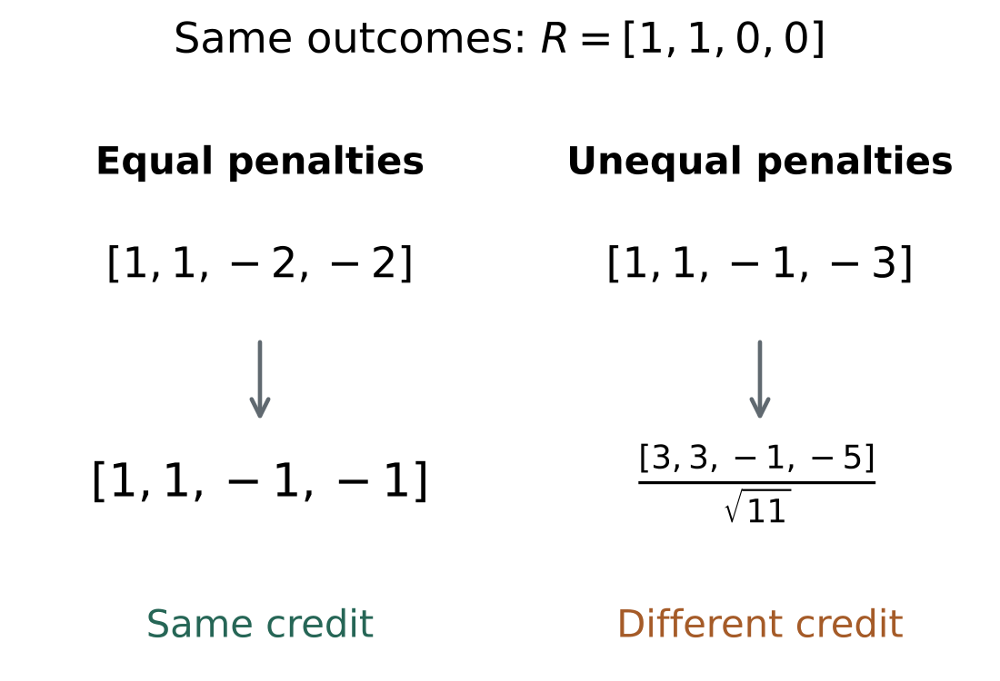

<h1 align="center">What Survives Group Normalization?</h1>
<p align="center"><strong>A Credit-Assignment Audit of Reward Shaping in GRPO</strong></p>
<p align="center">
  <a href="paper/grpo-reward-shaping.pdf">Paper</a> &middot;
  <a href="https://pritishsaha92.github.io/predictive-is-not-actionable/">Blog</a> &middot;
  <a href="docs/REPRODUCING.md">Reproduce</a> &middot;
  <a href="docs/RESULTS.md">Results</a>
</p>

A reward can predict correctness without adding much new direction after GRPO normalizes it. And when shaping does change the advantages, their geometry still cannot tell us whether the right completions received credit.

This repository accompanies our study of that distinction in GRPO training of Qwen2.5-Math-7B. It contains the offline analyses, saved model-gradient results and code needed to reproduce the reported calculations.

<p align="center">
  
</p>

*Four solutions, the same outcomes. Equal penalties leave the normalized advantages unchanged; unequal penalties introduce a preference between the two failures. This example uses population standard deviation with no numerical stabilizer.*

## Reproduce the results

**Python 3.12** is the tested version. The default workflow runs on CPU using bundled records. After installing dependencies, it needs no network connection, credentials or model weights.

```bash
git clone https://github.com/PritishSaha92/grpo-reward-shaping.git
cd grpo-reward-shaping
python -m venv .venv
```

Activate the environment with `source .venv/bin/activate` on Linux/macOS, or `.\.venv\Scripts\Activate.ps1` in Windows PowerShell. Then run:

```bash
python -m pip install -r requirements.txt
python scripts/verify_repository.py
python scripts/reproduce.py
```

The workflow writes its reports to `reproduced/`, leaving the supplied evidence intact. Its final `verification.json` lists each comparison, numerical errors and whether the files also match byte-for-byte. Input hashes remain strict; regenerated JSON and CSV are compared as data, so line endings do not cause a failure. For a repeat, choose a fresh destination:

```bash
python scripts/reproduce.py --output reproduced-again
```

This recomputes the analyses from saved rewards and gradient summaries. Running model backpropagation again is a separate workflow described in [Model replay](docs/MODEL_REPLAY.md). The [reproduction guide](docs/REPRODUCING.md) explains each CPU stage and figure regeneration.

## Main findings

The offline analysis uses **4,000 completions from 500 MATH-500 test prompts**. The model replay covers **all 185 mixed groups and their 1,480 completions**.

| Measurement | Result |
|---|---:|
| Learned vs. binary advantage cosine | 0.9786 |
| Prompts that permit within-incorrect differentiation | 132 / 500 (26.4%) |
| Learned vs. binary model-gradient cosine | 0.9844 |
| Learned residual norm / binary-gradient norm | 17.48% |
| Learned vs. length residual-gradient cosine | -0.0026 |

Permuting the learned penalties among incorrect completions preserves the reported advantage geometry, yet can change the measured gradient. The replay measures this assignment sensitivity; it does not show which assignment improves task performance.

[Detailed results and plots](docs/RESULTS.md) include all 32 learned-penalty permutations and the exact reference for both learned and length penalties. [The evidence map](docs/EVIDENCE_MAP.md) links each result to its source.

## Repository guide

| Path | Contents |
|---|---|
| [`experiments/offline/`](experiments/offline/) | Learned, constant and length rules under two normalization conventions |
| [`experiments/assignment/`](experiments/assignment/) | Residual comparisons, conditional distributions and permutation checks |
| [`experiments/replay/`](experiments/replay/) | Complete 185-group replay, execution code, pinned inputs and saved gradient summaries |
| [`experiments/pilot/`](experiments/pilot/) | Earlier 32-group replay, kept as a labelled subset comparison |
| [`experiments/validation/`](experiments/validation/) | Checks of the decomposition, alignment floor and permutation identity |
| [`experiments/historical/`](experiments/historical/) | Original task evaluation, correctness discrimination and training coverage |
| [`paper/`](paper/) | Current manuscript PDF and its checksum |
| [`scripts/`](scripts/) | Reproduction, integrity checks and figure generation |
| [`figures/`](figures/) | Vector figures, editable sources and README previews |
| [`docs/`](docs/README.md) | Methods, results and reproduction guides |
| [`provenance/`](provenance/) | Source records, integrity manifests and verification reports |

The experiment directories retain the paths used by the reproduction scripts. Start with the [documentation index](docs/README.md) rather than opening every saved record.

## Scope

This is a fixed-sample study of one model and benchmark. Replay prompts were reconstructed because the original prompt token IDs were not saved. The original learned head also had a gradient-clearing/clipping defect. The recorded task comparison and later analysis do not isolate normalization as the cause of its training outcome.

Corrected multi-seed training and new decoding are not included. The original evaluation, later generation sample and training history have different populations; [scope notes](docs/SCOPE.md) keep them separate. The [verification report](docs/VERIFICATION.md) states what can be reproduced from this release.

## Citation

If you use the analysis or code, please cite the accompanying manuscript:

```bibtex
@unpublished{saha2026normalization,
  author = {Saha, Pritish},
  title = {What Survives Group Normalization? A Credit-Assignment Audit of Reward Shaping in {GRPO}},
  year = {2026},
  note = {Research manuscript},
  url = {https://pritishsaha92.github.io/predictive-is-not-actionable/assets/paper/grpo-reward-shaping.pdf}
}
```

## Acknowledgements and license

This work began in my bachelor's thesis at IIT Kharagpur. I thank Prof. Pawan Goyal for supervising the thesis and for his guidance.

Original code is [MIT licensed](LICENSE); original text and figures use [CC BY 4.0](LICENSE-CONTENT.md). Third-party material retains its own terms; see [THIRD_PARTY_NOTICES.md](THIRD_PARTY_NOTICES.md).
