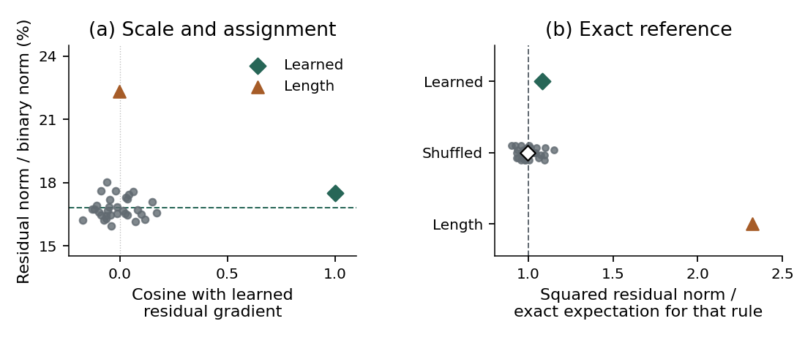

# Results

The offline comparison uses 500 MATH-500 prompts with eight completions each. The model-gradient replay covers all 185 mixed groups in that sample. Historical training used groups of 16; these counts describe the later test sample.

| Measurement | Result | Population |
|---|---:|---|
| Learned–binary advantage cosine | 0.9786 | 500 prompts, 8 completions each |
| Learned–length advantage cosine | 0.9684 | Same saved sample |
| Learned–length within-group residual cosine | 0.2303 | Same saved sample |
| Prompts permitting within-incorrect differentiation | 132 / 500 | 185 mixed groups, including 53 with one incorrect completion |
| Learned–binary model-gradient cosine | 0.9844 | All 185 mixed groups, 1,480 completions |
| Learned residual norm / binary-gradient norm | 17.48% | Same complete replay |
| Learned–length residual-gradient cosine | −0.0026 | Same complete replay |
| Learned squared residual norm / exact permutation expectation | 1.0824× | Conditional on fixed computed gradients |
| Length squared residual norm / its own exact expectation | 2.3213× | Conditional on the same computed gradients |

The learned ratio lies within the range of its 32 sampled reassignments
(0.8994–1.1500); four draws exceed the observed norm. No length-penalty shuffles
were collected. Its 2.3213× ratio is descriptive, with no significance or
learning-quality claim. Length also enters sequence-mean gradient weighting;
the replay does not isolate that interaction.

## Gradient scale and assignment

The left panel compares the residual gradient with the learned assignment. Gray points are the 32 within-incorrect permutations of the learned penalties. The horizontal dashed line marks the root expected squared residual norm for those permutations, divided by the binary-gradient norm. The right panel compares each rule with its own exact expectation. It includes the learned and length assignments, plus the sampled learned permutations.

These permutations preserve advantage geometry while changing which completion receives each penalty. The resulting gradient differences establish assignment sensitivity; they do not identify which assignment improves learning.

## Inspect the records

| Question | Record |
|---|---|
| What are the offline advantage comparisons? | [Full geometry](../experiments/offline/results/tables/full_geometry.csv) |
| How do learned and length residuals compare? | [Assignment summary](../experiments/assignment/results/summary.json) |
| What did the complete model replay measure? | [Replay summary](../experiments/replay/results/summary.json) |
| Where are all 32 sampled assignments? | [Permutation ledger](../experiments/replay/results/permutation_draws.csv) |
| How is the exact expectation calculated? | [Per-group reference](../experiments/replay/results/group_reference.csv) |
| Where does each paper claim come from? | [Evidence map](EVIDENCE_MAP.md) |

For estimator details and limitations, see [Model replay](MODEL_REPLAY.md) and [Scope](SCOPE.md). For the earlier 32-group subset, use the explicitly labelled pilot records; its measurements are not the full-sample results.
